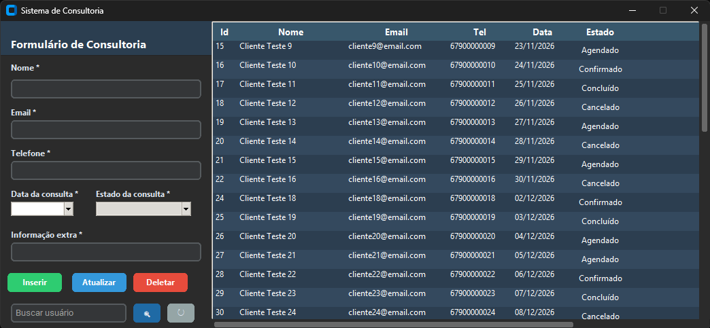

# Sistema de Consultoria (CRUD Desktop)

Aplicação desktop em Python para gerenciamento de agendamentos de consultoria, com interface em modo escuro e persistência de dados em banco relacional MySQL.



## Funcionalidades

- **Cadastro e edição:** inserção e atualização de registros (nome, e-mail, telefone, data, status e informações extras) com validação contra campos vazios ou preenchidos apenas com espaços.
- **Visualização interativa:** tabela estilizada com linhas alternadas (`Treeview`) e preenchimento automático do formulário ao selecionar um registro.
- **Exclusão segura:** suporte à remoção de um ou múltiplos registros com caixa de confirmação antes de apagar do banco.
- **Busca dinâmica:** filtro por ID exato ou trecho do nome, com botão de reset para recarregar a listagem completa.
- **Segurança e tratamento de falhas:** queries parametrizadas contra SQL Injection, credenciais isoladas via `.env`, fechamento garantido de conexões (`try/finally`) e captura de erros do MySQL na interface (`try/except`).

## Tecnologias Utilizadas

- **Python 3**
- **CustomTkinter** e **Tkinter (`ttk`)** — interface gráfica
- **tkcalendar** — seletor de datas (`DateEntry`)
- **MySQL** e **mysql-connector-python** — banco de dados e driver de conexão
- **python-dotenv** — leitura de variáveis de ambiente

## Estrutura do Projeto

```text
.
├── main.py            # Interface gráfica e eventos dos botões
├── view.py            # Conexão com o MySQL e operações CRUD
├── banco.py           # Script de criação inicial da tabela
├── requirements.txt   # Dependências do projeto
├── .env.example       # Modelo das variáveis de ambiente
└── .gitignore         # Arquivos ignorados pelo Git
```

## Como Executar Localmente

### 1. Pré-requisitos
- Python 3.10+ instalado
- Servidor MySQL em execução

### 2. Clonar o repositório e instalar dependências
```bash
git clone git@github.com:fernando-ccarvalho/sistema-consultoria.git
cd sistema-consultoria
pip install -r requirements.txt
```

### 3. Configurar o banco de dados
Crie o banco de dados no MySQL (via Workbench ou terminal):
```sql
CREATE DATABASE consultoria;
```

Crie um arquivo `.env` na raiz do projeto usando o `.env.example` como modelo e preencha com suas credenciais locais:
```env
DB_HOST=localhost
DB_USER=seu_usuario
DB_PASSWORD=sua_senha
DB_NAME=consultoria
```

### 4. Criar a tabela e rodar a aplicação
Execute o script de criação da tabela uma vez:
```bash
python banco.py
```

Inicie o sistema:
```bash
python main.py
```